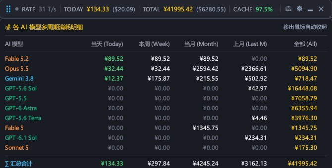

# AI Token HUD

<div align="center">


**桌面悬浮的 AI Token 与费用实时监视器**

一条 36px 高的置顶横条，形态类似 RivaTuner (RTSS) 的硬件 OSD。  
实时显示 Claude Code、Codex、Antigravity 等工具的输出流速、今日费用、历史累计与缓存命中率。  
由文件写入事件驱动刷新，空闲时 CPU 占用为 0%，内存约 15MB。

</div>

<div align="center">


> 上图及下文的金额均为示例数据。
</div>
---

## 功能

- **HUD 横条**：显示输出流速 `RATE (T/s)`、今日费用 `TODAY`、历史累计 `TOTAL`、Prompt 缓存命中率 `CACHE%`。可按工具、按模型、仅金额三种模式展示，背景透明度 40%～100% 可调。
- **每日预算**：设置额度后，横条底部显示进度线，`TODAY` 达到 80% 变橙，超支变红。
- **空闲指示**：`RATE` 只统计输出 Token，并过滤耗时小于 100ms 的异常记录；超过 60 秒无新请求时指示灯置灰。
- **多周期明细面板**：金额模式下鼠标悬停横条，展开各模型在当天、本周、当月、上月、全部五个周期的费用；移开鼠标后自动收起。
- **记录详情查看器**：月历热力图（底色深浅对应当日金额占当月峰值的比例）、8 档预置时间范围、点击日历自选起止日期、各模型 Token 与费用明细表，支持关键词过滤，可一键复制为 TSV 粘贴进 Excel。
- **计价**：内置 50+ 模型的官方单价（Claude、OpenAI、Gemini、DeepSeek、Qwen、Grok、Kimi 等），支持自定义输入、输出与缓存读写单价。数据源中未计价的记录会按内置单价表补算；没有公开单价的模型保持 $0。
- **汇率**：USD / CNY 双币种显示，汇率可手动填写，也可从公开接口获取并在每次启动时自动同步。
- **系统托盘**：不占用任务栏，可收起到托盘；位置自动记忆，拖出屏幕后可从托盘菜单复位。
- **开机自启动**：在「展现与偏好」中勾选后，登录 Windows 时自动运行；移动 exe 后下次启动会自动更新登记的路径。

## 界面示意

### 多周期明细面板

<div align="center">



</div>
### 设置与统计窗口

点击横条上的 `📅` 或 `⚙` 打开，共 5 个选项卡：

| 序号 | 选项卡 | 内容 |
| :--- | :--- | :--- |
| 0 | 记录详情查看器 | 月历热力图、时间范围筛选、模型明细表与汇总 |
| 1 | 完整下钻明细 | 以模型或工具为视角的树状层级统计 |
| 2 | 计价与汇率设置 | 汇率配置、模型单价编辑 |
| 3 | 展现与偏好 | 展示模式、结算货币、每日预算、透明度、始终置顶、开机自启动 |
| 4 | 驱动与监控工具 | 数据源策略、已安装工具检测与显隐开关 |

## 数据来源

统计有两种数据源，默认自动选择：检测到 CC Switch 时读取其数据库，否则扫描各工具的本地会话记录。也可以在设置中强制指定其一。

| 数据源 | 读取位置 | 说明 |
| :--- | :--- | :--- |
| [CC Switch](https://github.com/farion1231/cc-switch) | `~/.cc-switch/cc-switch.db` | 只读打开，读取 `proxy_request_logs` 与 `usage_daily_rollups`，可获得归档后的长期历史 |
| Claude Code | `~/.claude/projects/` | 原生扫描 |
| Google Antigravity | `~/.gemini/antigravity/brain/`、`~/.gemini/antigravity-cli/brain/` | 原生扫描 |
| Codex | `~/.codex/sessions/` | 原生扫描 |

`~` 即 `%USERPROFILE%`。原生扫描按文件游标增量解析，不依赖任何外部软件。

## 隐私

- 所有数据源均以只读方式访问，不修改任何工具的会话文件或数据库。
- 统计结果只保存在本机，不上传。
- 唯一的联网行为是获取汇率：通过系统自带的 `curl.exe` 请求 `open.er-api.com`（备用 `api.exchangerate-api.com`），仅在点击获取按钮或开启了启动自动同步时发生。

## 编译与运行

需要 Windows 10 / 11 (x64) 与 Rust 1.85+（MSVC 工具链）。

```bash
git clone https://github.com/WuDuKangBaZi/ai-token-hud.git
cd ai-token-hud
cargo test
cargo build --release
```

编译产物为 `target/release/ai-token-hud.exe`，双击即可运行，不会弹出控制台窗口。

加上 `--settings <序号>` 可在启动后直接打开对应选项卡（序号见上表）：

```bash
target/release/ai-token-hud.exe --settings 0
```

### 配置文件

| 文件 | 位置 | 内容 |
| :--- | :--- | :--- |
| `config.json` | `~/.ai-token-hud/` | 设置、汇率、自定义单价、驱动模式 |
| `history_cache.json` | `~/.ai-token-hud/` | 历史统计缓存 |
| `native_cursors.json` | `~/.ai-token-hud/` | 原生扫描的文件游标 |

删除这三个文件即可恢复初始状态。

开启「开机自动启动」时，程序会在注册表 `HKCU\Software\Microsoft\Windows\CurrentVersion\Run` 下写入名为 `AiTokenHud` 的值，这是程序唯一写入注册表的地方。卸载前请先在设置中关闭该选项，再删除 exe。

## 操作速查

| 操作 | 效果 |
| :--- | :--- |
| 左键拖拽横条 | 移动位置，停下后自动记忆 |
| 双击横条 / 点击 `⚙` | 打开或关闭设置与统计窗口 |
| 点击 `📅` | 打开记录详情查看器 |
| 点击 `🗕` | 收起到系统托盘 |
| 鼠标悬停横条 | 金额模式下展开多周期明细面板 |
| 右键横条 | 快捷菜单：切换展示模式与币种、打开日历或设置、收起、退出 |
| 右键托盘图标 | 显示或隐藏横条、复位到屏幕顶部居中、退出 |
| 日历中依次点击两个日期 | 自选统计范围 |

## 代码结构

```text
src/
├── main.rs           # 入口、无边框透明窗口初始化、CJK 字体加载
├── app.rs            # 界面：HUD 横条、明细面板、日历与表格、设置窗口
├── autostart.rs      # 开机自启动（当前用户的注册表 Run 项）
├── collector.rs      # 采集调度（CC Switch / 原生扫描）与输出速率计算
├── config.rs         # 配置持久化、模型单价表、统一计价、汇率获取
├── detector.rs       # 检测本机已安装的 AI 工具
├── history_cache.rs  # 历史统计缓存与 CC Switch 归档数据聚合
├── native_scanner.rs # Claude Code / Antigravity / Codex 会话的增量解析
├── range_stats.rs    # 时间范围计算、日历排布、热力比例、TSV 格式化
├── stats.rs          # 按工具、按模型的聚合与多周期费用统计
├── theme.rs          # 调色板、深色主题、品牌与模型配色
├── tray.rs           # 系统托盘图标与菜单、窗口位置复位
└── watcher.rs        # 基于 ReadDirectoryChangesW 的文件写入监听
```

## 致谢

感谢开源项目 [CC Switch](https://github.com/farion1231/cc-switch)。本项目读取其本地数据库中的请求日志与每日归档表，借此获得跨工具的统一统计与完整的长期历史。

## 许可证

[MIT License](LICENSE)。欢迎提交 Issue 与 Pull Request。
